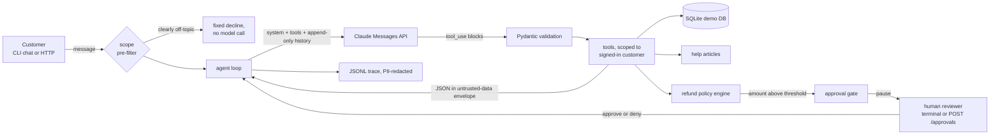
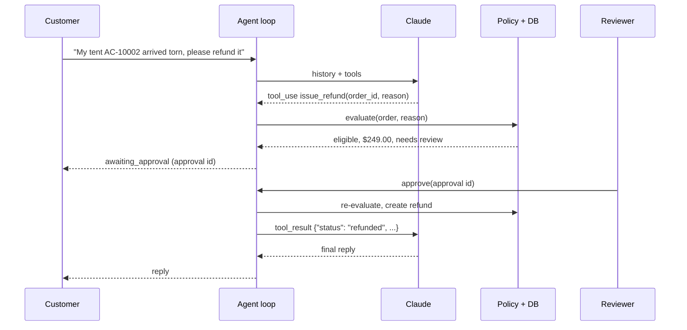

# claude-support-agent

[](https://github.com/rahulkumar96t/claude-support-agent/actions/workflows/ci.yml)

A customer-support agent for a fictional outdoor-gear shop, built directly on the Claude
Messages API tool-use loop. The model talks to the customer and decides which tool to call;
the code decides what is allowed. Refund eligibility and amounts come from a written policy
implemented in Python, refunds above a threshold pause the conversation until a human
approves them, every tool only sees the signed-in customer's data, tool output reaches the
model as untrusted JSON, and every conversation leaves a PII-redacted JSONL trace. It runs as
a terminal chat or a FastAPI service, and the whole test suite runs offline against a
scripted model.

## Features

- **Bounded agent loop** on the Messages API: max model calls per request, a per-call timeout
  and a wall-clock deadline, with explicit stop reasons (`completed`, `awaiting_approval`,
  `max_turns`, `timeout`, `refusal`, `out_of_scope`).
- **Six tools defined from Pydantic models**: `lookup_order`, `get_shipment_status`,
  `check_refund_eligibility`, `issue_refund`, `create_ticket`, `search_knowledge_base`. The
  JSON schemas are sent with `strict: true`; the same models validate the arguments before
  anything runs.
- **Written refund policy, enforced in code**: [`refund-policy.md`](src/support_agent/kb/refund-policy.md)
  (30/60-day windows, excluded categories, one refund per order, $500 self-service cap,
  review above $100) is implemented in `policy.py`, and a test checks that the numbers in
  the document match the code. `issue_refund` has no amount parameter.
- **Human approval gate**: a refund above the threshold is held; the conversation pauses
  with an approval id, a reviewer approves or denies (terminal prompt or
  `POST /approvals/{id}`), the policy is re-checked, and the loop resumes with the result.
- **Prompt-injection-aware tool handling**: tool results are JSON inside a
  `<tool_output trust="untrusted-data">` envelope that a value cannot close early;
  instruction-like text is flagged. A test plants an instruction in an order note and drives
  a model that obeys it; the code still refuses the amount and holds the refund for review.
- **Customer scoping**: every query filters by the conversation's customer, so another
  customer's order is "not found" regardless of what the model asks for.
- **Out-of-scope handling**: the system prompt tells the model to decline politely, and a
  cheap regex pre-filter answers obviously off-topic requests without a model call.
- **PII redaction in traces and logs** (emails, phone numbers, Luhn-valid card numbers,
  street addresses, and the signed-in customer's own name, email, phone and address). The
  model-facing history is never rewritten.
- **JSONL traces**, one file per conversation: user messages, model responses (stop reason,
  tokens, latency, tool calls), tool calls and results, approvals, and turn outcomes.
- **CLI chat and FastAPI service** over the same agent.

## Architecture



A refund above the threshold, step by step:



| Module | Responsibility |
|---|---|
| `agent.py` | loop, budgets, approval pause/resume, conversation registry |
| `model.py` | `ModelClient` protocol, `ClaudeModel` (Anthropic SDK), history helpers |
| `tools.py` | Pydantic input models, strict schemas, customer-scoped handlers |
| `policy.py` | the refund policy as deterministic rules |
| `guardrails.py` | tool-output envelope, injection flags, scope pre-filter |
| `redact.py`, `trace.py` | PII redaction, JSONL traces |
| `db.py`, `kb.py` | SQLite demo data, help-article search |
| `api.py`, `cli.py` | FastAPI service, command line |

## Quickstart

Requires [uv](https://docs.astral.sh/uv/) and Python 3.11+.

```bash
uv sync
uv run support-agent seed            # creates support-demo.db (git-ignored)
uv run support-agent tools           # prints the tool definitions sent to the model

export ANTHROPIC_API_KEY=...         # only chat and serve call the API
uv run support-agent chat --customer C-1001
uv run support-agent serve --port 8000
```

The API key is read from the environment by the Anthropic SDK; it is never a CLI flag or a
config value.

| Variable | Default | Meaning |
|---|---|---|
| `SUPPORT_AGENT_MODEL` | `claude-sonnet-5-5` | model id |
| `SUPPORT_AGENT_EFFORT` | `medium` | `low` … `max`, or `none` to omit `output_config.effort` |
| `SUPPORT_AGENT_FALLBACKS` | `default` | server-side refusal fallback; `off` disables it |
| `SUPPORT_AGENT_MAX_TURNS` | `8` | model calls per request |
| `SUPPORT_AGENT_TIMEOUT` | `60` | seconds per model call |
| `SUPPORT_AGENT_DEADLINE` | `180` | seconds per request, across all model calls |
| `SUPPORT_AGENT_APPROVAL_THRESHOLD` | `100.00` | refunds above this need a reviewer |
| `SUPPORT_AGENT_DB` | `support-demo.db` | SQLite file |
| `SUPPORT_AGENT_TRACE_DIR` | `traces` | JSONL trace directory |

**Refusal fallback is on by default.** Requests go through `client.beta.messages.create`
with the `server-side-fallback-2026-07-01` beta and `fallbacks="default"`, so a turn declined
by a safety classifier can be retried server-side on the model Anthropic recommends for
that category. Set `SUPPORT_AGENT_FALLBACKS=off` to use the plain endpoint (for example with
a model or platform that does not support server-side fallback). A final
`stop_reason: "refusal"` is always handled before content is read.

## Usage examples

Demo data (all fictional): two customers and nine orders chosen to exercise the policy.

| Order | Customer | What it exercises |
|---|---|---|
| AC-10001 | C-1001 | delivered 5 days ago, $89.00: refund issued automatically |
| AC-10002 | C-1001 | delivered 10 days ago, $249.00: refund needs approval |
| AC-10003 | C-1001 | delivered 45 days ago: outside the 30-day window unless damaged |
| AC-10004 | C-1001 | in transit, has tracking events |
| AC-10008 | C-1001 | already refunded |
| AC-10005 | C-1002 | gift card + clearance socks: nothing refundable for a change of mind |
| AC-10006 | C-1002 | $640.00: above the self-service cap, escalate to a ticket |
| AC-10007 | C-1002 | checkout note contains a prompt-injection attempt |
| AC-10009 | C-1002 | still processing, not shipped |

Things to try in `support-agent chat --customer C-1001`:

- "Where is my sleeping bag? Order AC-10004."
- "The tent from AC-10002 arrived torn. Can I get my money back?" (then confirm; you are
  asked to act as the reviewer in the same terminal)
- "Can you refund AC-10005?" while signed in as C-1001 (another customer's order)
- "Write me a poem about the sea."

Over HTTP:

```bash
curl -s -X POST localhost:8000/conversations -H 'content-type: application/json' \
  -d '{"customer_id": "C-1002"}'
# {"conversation_id":"conv_…","customer_id":"C-1002","status":"active","transcript":[],"pending_approvals":[]}

curl -s -X POST localhost:8000/conversations/conv_…/messages -H 'content-type: application/json' \
  -d '{"text": "What is going on with order AC-10007?"}'
# {"conversation_id", "stop_reason", "reply", "status", "tool_calls", "pending_approvals", "model_calls"}

curl -s localhost:8000/approvals                       # reviewer queue
curl -s -X POST localhost:8000/approvals/apr_… -H 'content-type: application/json' \
  -d '{"approve": true, "reviewer": "sam"}'
```

`GET /conversations/{id}` returns the transcript and any pending approvals. Sending a
message while a refund is awaiting a decision returns `409`; model API errors return `502`.

## Design decisions and trade-offs

- **A hand-written loop instead of the SDK tool runner.** The runner would remove the loop
  code, but here the loop has to stop mid-turn for an approval that may arrive minutes later
  in a different HTTP request, record a trace event per step, and take a model client that
  tests can replace with a script. Owning the loop keeps those explicit.
- **The model proposes, the code disposes.** Eligibility, amounts and approval are computed
  from the database and the policy. `issue_refund` takes only `order_id` and `reason`;
  the schema rejects extra fields, so "refund $5000" cannot even be expressed as a call.
  Prompting is a second line of defence, not the first.
- **Approval pauses keep the protocol intact.** When a call is gated, the other tool results
  of the same turn are held; after every gated call is decided, all results go back in one
  user message in the original order, so every `tool_use` gets exactly one `tool_result`.
  The policy is evaluated again at decision time, in case something changed meanwhile.
- **Append-only history.** Assistant turns are stored exactly as returned (including
  `thinking` blocks), the system prompt and tool list never change during a conversation,
  and nothing earlier is edited. That keeps prompt caching effective (top-level
  `cache_control`) and satisfies the API's check that replayed thinking blocks belong to an
  unchanged conversation. The one documented exception: after a server-side fallback, the
  declining model's non-text blocks before the `fallback` marker are dropped, as the API
  docs require.
- **Redact what is written down, not what the model sees.** Redaction applies to traces and
  logs. Redacting the history would change the conversation the model is reasoning about
  and break the append-only contract.
- **Untrusted tool output is data in an envelope, and the flags are advisory.** JSON
  encoding plus escaping `<`/`>` stops a value from breaking out of the envelope.
  Instruction-like text is flagged to the model and in the trace but not blocked, because
  real data can contain such words; the hard guarantees come from the code-level checks.
- **Strict tool schemas generated from Pydantic.** Strict tool use supports a subset of JSON
  Schema, so `minLength`, `pattern`, numeric bounds and titles are removed from the copy sent
  to the API and enforced locally by the same Pydantic model.
- **Claude API settings.** Default model `claude-sonnet-5-5`; no `thinking` parameter (the
  model runs adaptive thinking by default); effort `medium` as the starting point for
  multi-step tool use; no sampling parameters; `tool_choice` left at `auto`.
- **Synchronous and in-memory on purpose.** The agent is synchronous (FastAPI runs the
  endpoints in its thread pool) and conversations live in a process-local registry with
  per-conversation locks. Simple to reason about; see the limitations.

## Testing

```bash
uv run ruff check . && uv run ruff format --check . && uv run pytest -q
```

Measured locally on an Apple M4 Pro (macOS, Python 3.12.11 via uv): **90 passed, 1 skipped**.
The same suite also passes on Python 3.11 and 3.13; CI runs both on ubuntu-latest.

The tests need no network and no API key. A `ScriptedModel` implements the same
`ModelClient` protocol as `ClaudeModel` and returns real Anthropic SDK message objects
(`BetaMessage`, `BetaToolUseBlock`, …), so everything after the model call is the production
code path. Coverage by file:

- `test_agent_scenarios.py`: order lookup, auto refund, approval approve/deny, parallel calls
  with one gated call, policy refusals, cap escalation, the order-note injection, customer
  scoping, out-of-scope pre-filter, model refusal, max turns, model timeout, wall-clock
  deadline, invalid tool input, unknown/mis-cased tool names, truncated tool input,
  server-side fallback cleanup, trace redaction and the trace event sequence.
- `test_policy.py`: each rule and boundary, and the document-vs-code check.
- `test_tools.py`: strict schema shape, validation errors, normalisation, tickets, KB search.
- `test_guardrails_and_redaction.py`: envelope escaping, injection flags, pre-filter cases,
  redaction detectors and the logging filter.
- `test_model_and_config.py`: the exact request `ClaudeModel` builds (fallback beta, effort,
  no sampling parameters, timeout), SDK error mapping, history cleanup, env settings.
- `test_api.py`, `test_cli_and_live.py`: HTTP endpoints and status codes, CLI commands.

One live smoke test calls the real API; it is skipped unless both `ANTHROPIC_API_KEY` and
`RUN_LIVE_TESTS=1` are set. It was not run while building this repository (no key was
available), so behaviour against the live model is untested here.

## Limitations and roadmap

- Conversation state is in memory and lost on restart; a real service would persist
  conversations and approvals (SQLite or Redis) and run more than one worker.
- No authentication. `customer_id` should come from the customer's session, and the
  approval endpoints need staff authentication and an audit log.
- The scope pre-filter is a handful of English regexes. It is a cost saver for obvious
  cases, not a classifier; everything else relies on the system prompt.
- Redaction is pattern-based. It misses names other than the signed-in customer's,
  addresses in other formats and free-form identifiers. Treat traces as sensitive anyway.
- Injection flags are heuristics and easy to evade; they inform, they do not protect.
- The knowledge base is TF-IDF over four short articles.
- Replies are not streamed. Server-sent events for the final reply would improve latency
  perception.
- There is no evaluation of answer quality against the real model; the tests prove the
  harness, not the model's judgement. An eval set of scripted customer conversations scored
  against expected tool calls would be the next step.
